<div align="center">

# 💧 AqylSu

### Умное управление поливом: от датчика влажности до воды на грядке

Интерактивная 3D-симуляция автоматического полива.<br>
Один файл, без установки, работает без интернета.


**[🌐 Открыть демо](https://ВАШ_ЛОГИН.github.io/aqylsu/)** · **[🎓 Шпаргалка для защиты](docs/DEFENSE.md)** · **[📋 История изменений](CHANGELOG.md)**

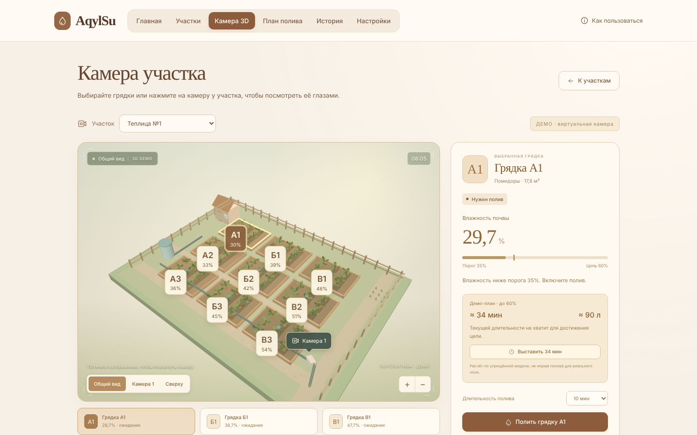

</div>

---

## 📖 О проекте

В сельском хозяйстве вода — главный ресурс. Полив «по ощущениям» ведёт к двум крайностям: растения пересыхают или почва переувлажняется, а вода тратится зря.

**AqylSu** показывает альтернативу: система следит за влажностью почвы каждой грядки, сама определяет, где нужен полив, считает время и расход воды и останавливается, когда цель достигнута.

Проект сделан как **учебная модель**: на ней можно наглядно показать принцип работы умного полива без железа, датчиков и насосов.

> *AqylSu* — «умная вода» (каз. *ақыл* — разум, *су* — вода).

## ✨ Возможности

| | Что умеет |
|---|---|
| 🌱 **Участки и грядки** | Несколько участков (теплица, открытый грунт и т.д.). У каждого своя культура, площадь, расход воды, порог и целевая влажность. На участке 9 грядок: А1–А3, Б1–Б3, В1–В3. |
| 🎥 **Камера 3D** | Участок виден сверху и в перспективе. Можно вращать, приближать, переключать ракурсы, выбирать любую грядку. Вода показана только там, где идёт полив. |
| 🤖 **Автополив** | Когда влажность падает ниже порога, система включает полив и останавливается на целевом значении или по лимиту времени. |
| 📋 **План полива** | Список «Что полить сейчас» от самой сухой грядки с временем и литрами до цели. Один запуск ограничен 60 минутами. |
| ⏰ **Расписание** | Ежедневный полив в удобное время. |
| 🛢 **Резервуар** | Запас воды, пополнение. Если вода закончилась, насосы останавливаются, а система предупреждает. |
| 📊 **История и аналитика** | Динамика влажности, расход воды по времени и по участкам, журнал событий. |
| ⏩ **Управление временем** | Скорость 1, 5 или 15 минут фермы в секунду, пауза и шаг в одну минуту. |
| 💾 **Данные** | Автосохранение в браузере, резервная копия в JSON, отчёт в CSV. |
| ♿ **Доступность** | Управление с клавиатуры, ссылка «Перейти к содержимому», подписи для экранных дикторов, адаптивная вёрстка для телефона. |

## 🖼 Скриншоты

<table>
  <tr>
    <td width="50%"><b>Главная.</b> Состояние фермы и что требует внимания<br>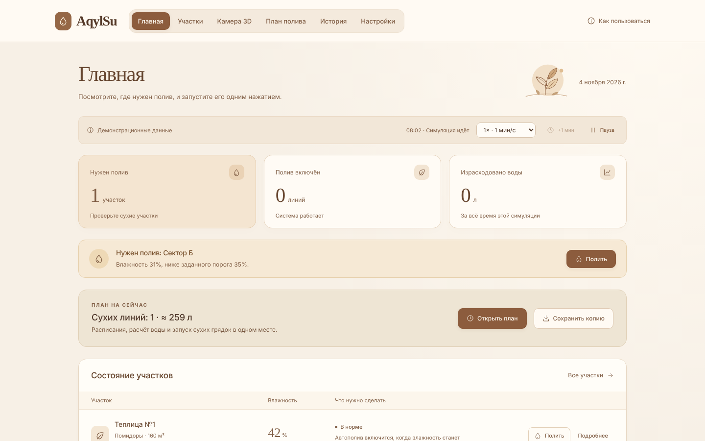</td>
    <td width="50%"><b>Идёт полив.</b> Вода видна только на выбранной грядке<br>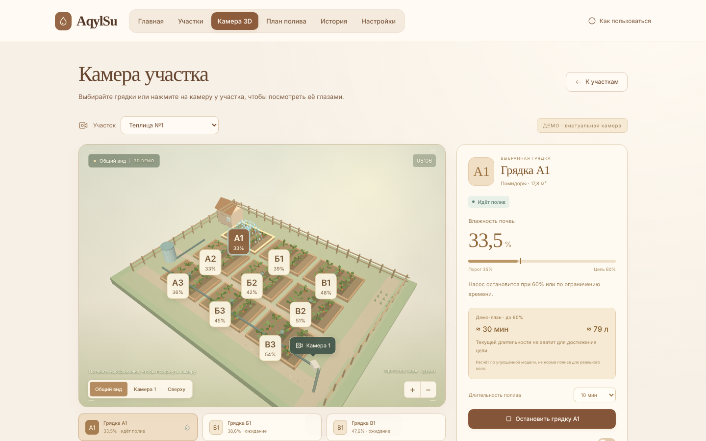</td>
  </tr>
  <tr>
    <td width="50%"><b>План полива.</b> Время и литры до целевой влажности<br>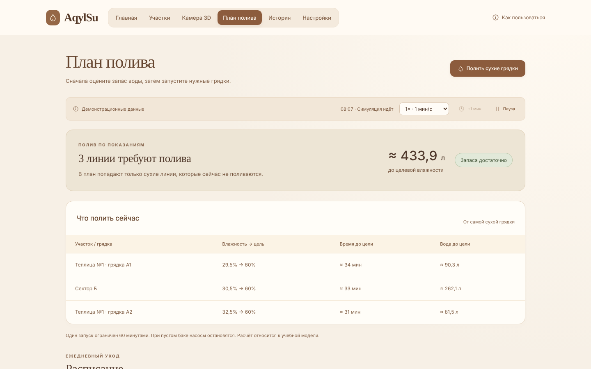</td>
    <td width="50%"><b>Аналитика.</b> Влажность и расход воды<br>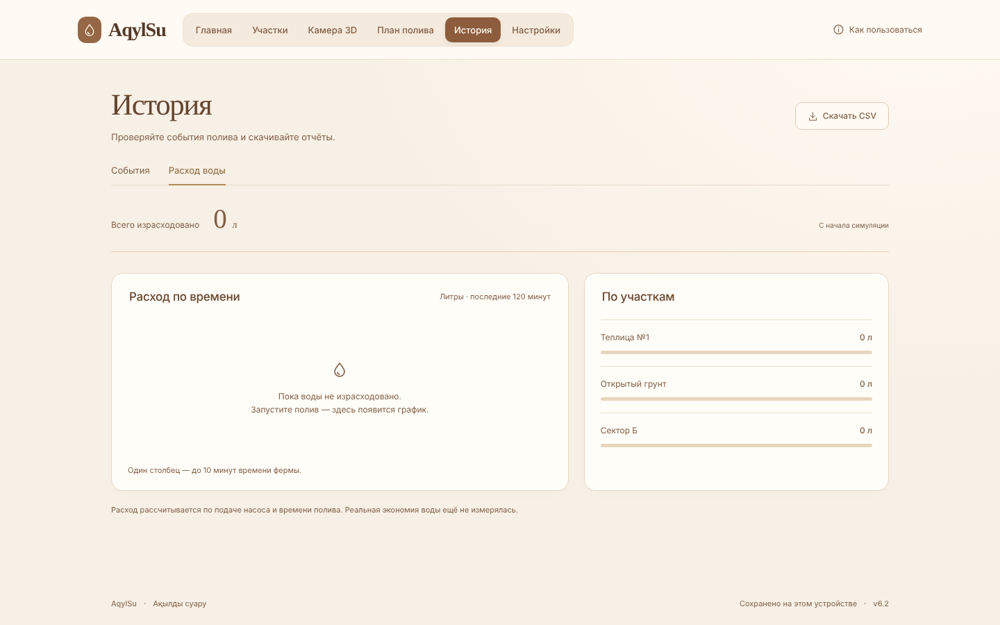</td>
  </tr>
  <tr>
    <td width="50%"><b>Участки.</b> Список и состояние грядок<br>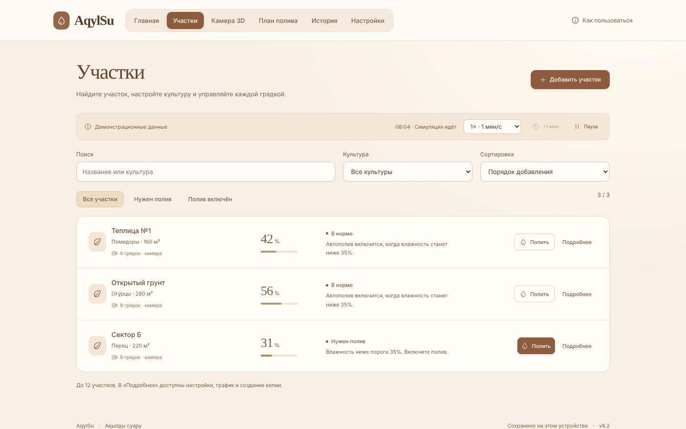</td>
    <td width="50%"><b>История.</b> Журнал событий и экспорт CSV<br>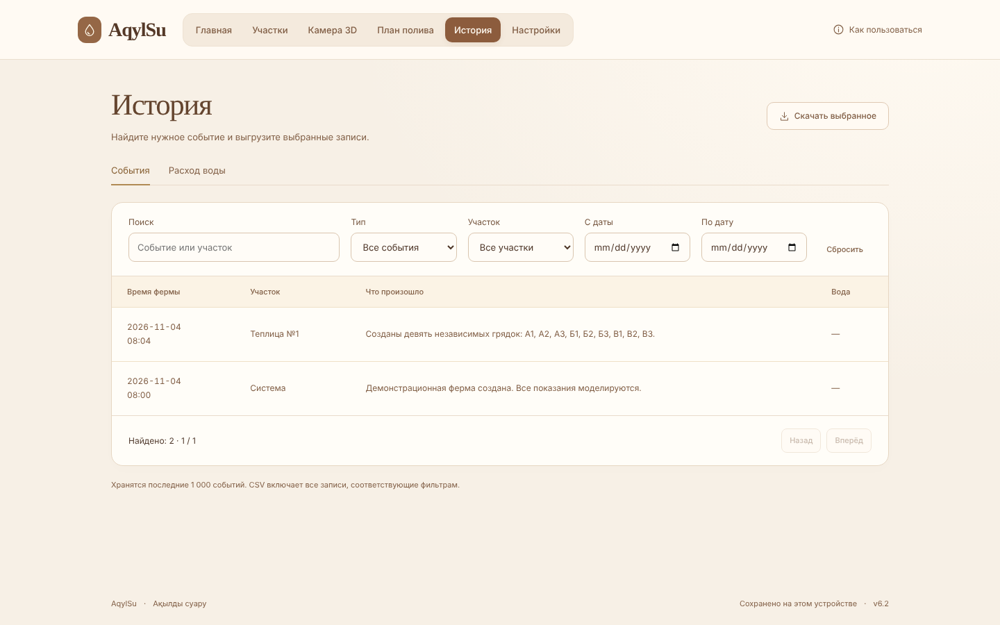</td>
  </tr>
</table>

<details>
<summary><b>📱 Мобильная версия, настройки и справка</b></summary>
<br>
<p align="center">
  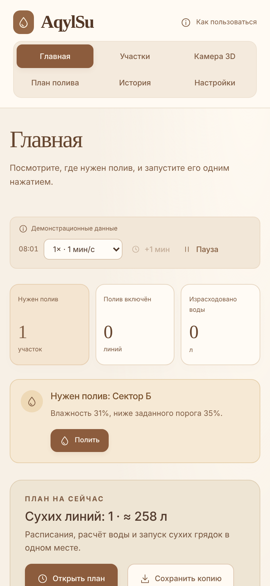
  &nbsp;
  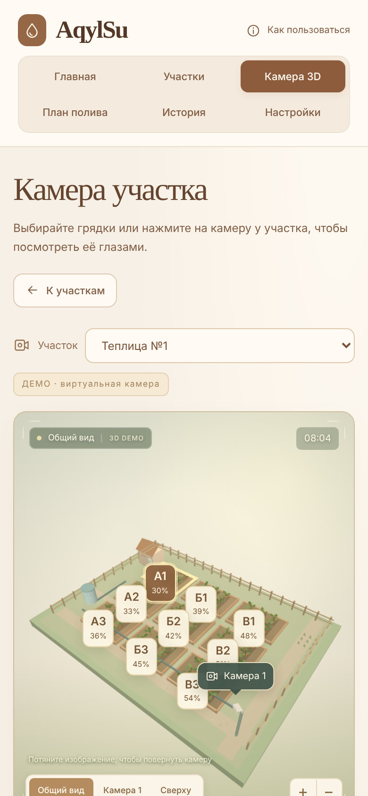
</p>
<p align="center">
  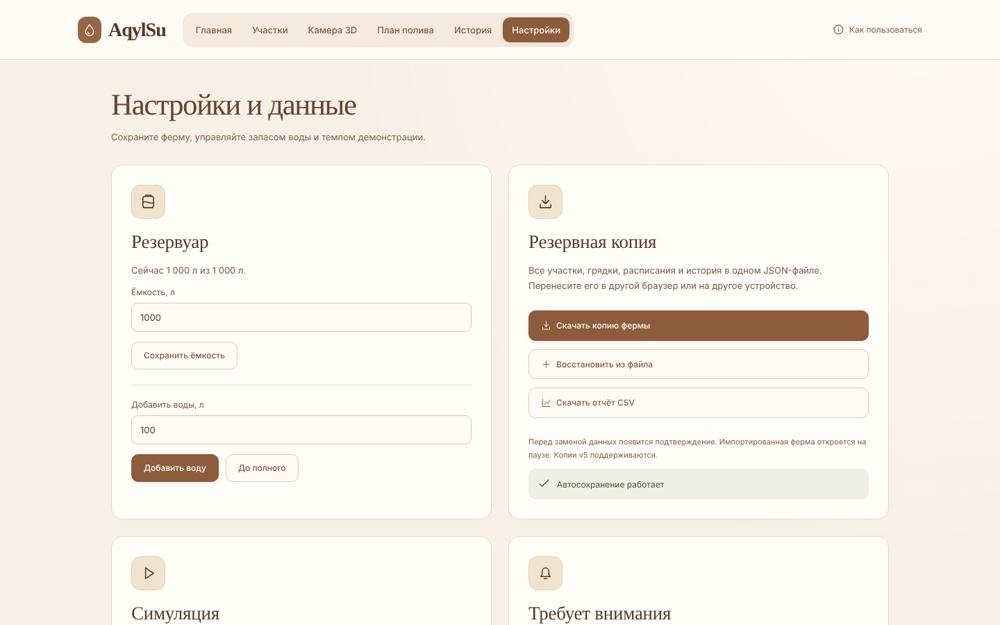
  &nbsp;
  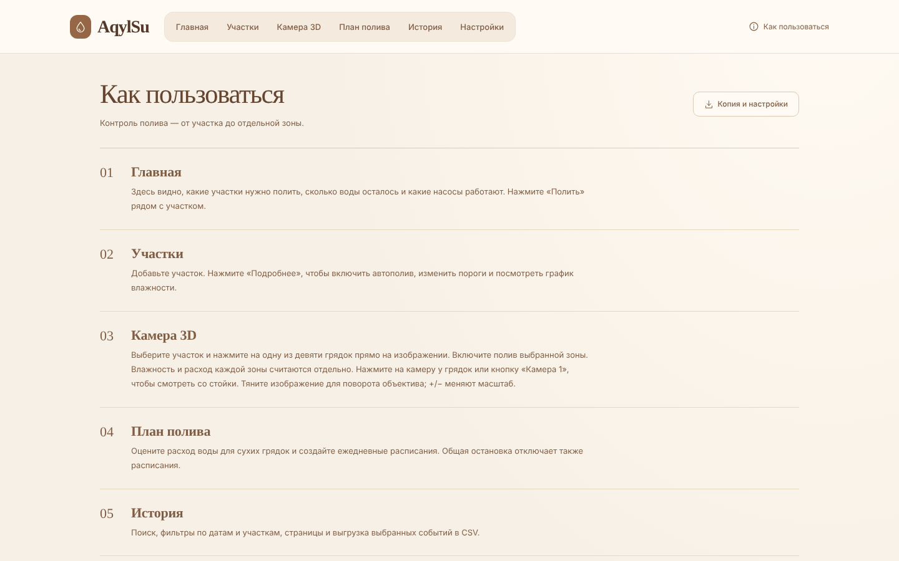
</p>
</details>

## 🚀 Быстрый старт

### Вариант 1. Открыть на компьютере (30 секунд)

1. Нажмите зелёную кнопку **Code → Download ZIP** и распакуйте архив.
2. Дважды щёлкните по файлу **`index.html`**.

Интернет, Node.js и установка библиотек не нужны.

### Вариант 2. Онлайн через GitHub Pages

1. Откройте **Settings → Pages** в репозитории.
2. В **Source** выберите **Deploy from a branch**, ветку `main` и папку `/ (root)`.
3. Нажмите **Save**. Через 1–2 минуты сайт откроется по адресу  
   `https://ВАШ_ЛОГИН.github.io/НАЗВАНИЕ_РЕПОЗИТОРИЯ/`.

## 🎮 Как попробовать за 1 минуту

1. Откройте **«Камеру 3D»** и выберите участок.
2. Щёлкните по грядке (например, **А1**): справа появятся влажность, порог и расчёт полива.
3. Нажмите **«Полить грядку»** и наблюдайте, как растёт влажность и появляется вода на грядке.
4. Включите скорость **15 мин/с**, чтобы ускорить время.
5. Откройте **«План полива»**, **«Историю»** и скачайте отчёт CSV.

Пошаговый сценарий показа проекта — в [шпаргалке для защиты](docs/DEFENSE.md).

## ⚙️ Как это работает

```
 датчик влажности ──► сравнение с порогом ──► нужен полив?
   (моделируется)            │                     │ да
                             │ нет                 ▼
                       ждём, ничего не          включить линию
                       тратим                        │
                                                     ▼
                                  растёт влажность, тратится вода из резервуара
                                                     │
                       цель достигнута / лимит времени / вода закончилась
                                                     │
                                                     ▼
                                       остановить полив, записать в историю
```

Для каждого участка задаются:

| Параметр | Смысл |
|---|---|
| **Культура** | Помидоры, огурцы, перец. Есть демопрофиль со значениями по умолчанию. |
| **Площадь** | От неё зависит расход воды. |
| **Расход** | Сколько воды подаёт линия за единицу времени. |
| **Порог** | Ниже этой влажности нужен полив. |
| **Цель** | До какой влажности поливать. |
| **Длительность** | Ограничение времени одного полива. |
| **Автополив** | Включать ли полив самостоятельно. |

## 💾 Данные и приватность

- Всё хранится в `localStorage` вашего браузера. **Ничего не отправляется на сервер**, регистрации нет.
- Перед очисткой данных браузера скачайте **JSON-копию** в разделе «Настройки». Её можно загрузить на другом устройстве.
- Импорт показывает подтверждение перед заменой данных. Копии версии v5 поддерживаются.
- Если браузер не даёт сохранять данные, приложение предупредит об этом.

## ⚠️ Важно: это учебная симуляция

Показания датчиков и расход воды **моделируются**. Реальные насосы и датчики не подключены. Пороговые значения заданы для демонстрации: в хозяйстве их подбирают под почву, культуру и калибровку датчика. Подсказки основаны на заданных порогах, а не на агрономическом прогнозе.

## 🗺 Планы развития

- [ ] Подключение реальных датчиков и реле (ESP32 / Arduino)
- [ ] Учёт прогноза погоды и осадков
- [ ] Профили культур с рекомендованными нормами
- [ ] Уведомления в Telegram
- [ ] Казахская и английская версии интерфейса
- [ ] Установка как приложение (PWA)

## 🛠 Технологии

- HTML5, CSS3, JavaScript (без фреймворков и сборки)
- 3D-сцена на `<canvas>`
- `localStorage` для сохранения состояния
- Адаптивная вёрстка и доступность (a11y)

## 🗂 Структура репозитория

```
aqylsu/
├── index.html          # всё приложение в одном файле
├── README.md           # этот файл
├── CHANGELOG.md        # история изменений
├── CONTRIBUTING.md     # как предложить улучшение
├── LICENSE             # лицензия MIT
├── docs/
│   ├── DEFENSE.md      # шпаргалка для защиты проекта
│   └── screenshots/    # изображения для README
├── .gitignore
└── .nojekyll           # отключает Jekyll на GitHub Pages
```

## 🤝 Участие в проекте

Нашли ошибку или есть идея? Откройте **Issue** или отправьте **Pull Request**. Подробности — в [CONTRIBUTING.md](CONTRIBUTING.md).

## 👤 Автор

**Nureke** — разработчик проекта.

*Өндіріс, технология, ауыл шаруашылығы.*

## 📄 Лицензия

[MIT](LICENSE) © 2026 Nureke. Можно свободно использовать, изменять и распространять.

---

<details>
<summary><b>🇬🇧 English summary</b></summary>

**AqylSu** is an educational smart-irrigation simulator that runs entirely in the browser from a single `index.html` — no build step, no dependencies, works offline.

It models soil-moisture sensors, automatic watering of individual beds in an interactive 3D camera view, a water reservoir, schedules, history charts and JSON/CSV export. Data is stored locally in `localStorage` and never leaves the device. Sensors and pumps are simulated; no real hardware is connected.

**Run:** download the ZIP and open `index.html`, or enable GitHub Pages (Settings → Pages → `main` / root).

</details>
